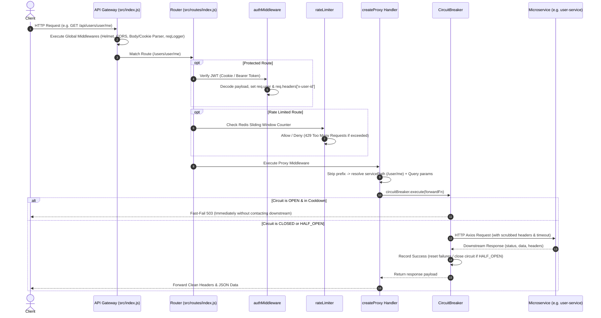
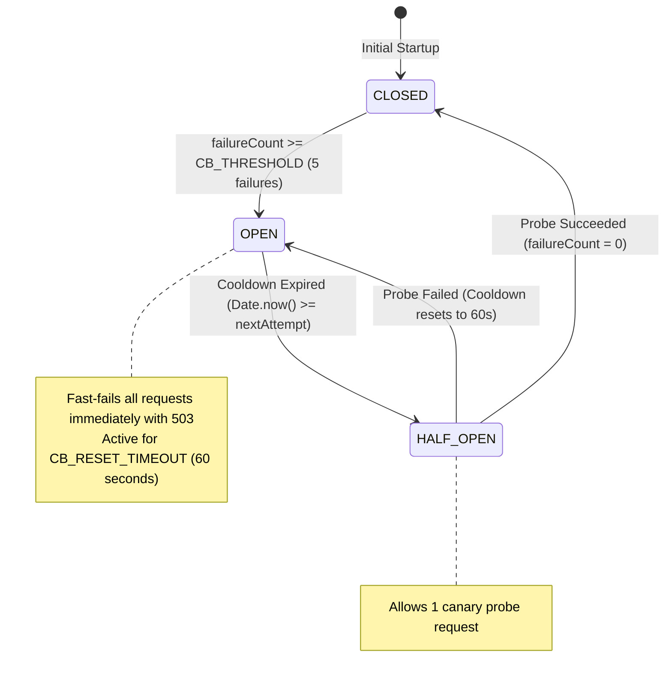

# IRCTC API Gateway: Architecture, Routing & Circuit Breaker Flow

This document details the architectural design and execution flow of the **IRCTC API Gateway**, explaining how incoming client traffic is validated, authenticated, rate-limited, routed through dynamic reverse proxies, and protected by resilient circuit breakers.

---

## 1. High-Level Architecture Overview

The API Gateway acts as the single entry point (reverse proxy) for all frontend clients, mobile apps, and external callers. It decouples clients from internal microservices and provides centralized cross-cutting concerns:

```
                  +----------------------------------------------+
                  |                 Client / UI                  |
                  +----------------------------------------------+
                                         |
                                         | HTTP / HTTPS Requests
                                         v
+---------------------------------------------------------------------------------+
|                               API GATEWAY (:4000)                               |
|                                                                                 |
|  [Global Middlewares]: Helmet -> CORS -> Body/Cookie Parsers -> Request Logger  |
|                                                                                 |
|  [Route Layer]: /api/users/* | /api/bookings/* | /api/search/* | /api/payments/*|
|                                                                                 |
|  [Security & Control]: authMiddleware (JWT)  <->  rateLimiter (Redis Sliding)  |
|                                                                                 |
|  [Proxy Layer]: createProxy() -> forwardRequest() -> [CircuitBreaker Engine]    |
+---------------------------------------------------------------------------------+
          |                      |                      |                     |
          v                      v                      v                     v
   +--------------+      +---------------+      +--------------+      +---------------+
   | user-service |      |booking-service|      |search-service|      |payment-service|
   |   (:5001)    |      |    (:5002)    |      |   (:5004)    |      |    (:5003)    |
   +--------------+      +---------------+      +--------------+      +---------------+
```

---

## 2. End-to-End Request Lifecycle

The diagram below illustrates the exact chronological execution path when a client issues a request (such as `POST /api/users/auth/login` or `GET /api/users/user/me`):



---

## 3. The `createProxy` Mechanism

The `createProxy(serviceName, serviceUrl)` function in [`src/services/proxy.js`](file:///d:/IRCTC%20Backend/api-gateway/src/services/proxy.js) is a **higher-order factory function**. It binds a specific downstream service URL with its dedicated `CircuitBreaker` instance and returns standard Express middleware:

```javascript
const userServiceProxy = createProxy("userService", config.services.USER);
router.post("/users/auth/login", userServiceProxy);
```

### Execution Steps inside `createProxy`:

1. **Circuit Breaker Binding**:
   - Resolves the circuit breaker matching `serviceName` from the `circuitBreakers` registry.
   - If not registered, dynamically instantiates a new `CircuitBreaker(serviceName)`.
2. **Path Normalization**:
   - Parses `req.path` by splitting segments:
     - Handles Gateway paths prefixed with `/api` or direct mounts.
     - Strips the top routing segment (e.g., `/users/auth/login` $\rightarrow$ `/auth/login`, or `/users/user/me` $\rightarrow$ `/user/me`).
   - Appends any query parameters (`?page=1&limit=10`) preserved from `req.url`.
3. **Execution via `forwardRequest`**:
   - Passes the target service URL, computed path, HTTP method, request body, headers, and the bound circuit breaker.
4. **Header Filtering & Sanitization**:
   - Excludes hop-by-hop and encoding headers (`connection`, `keep-alive`, `transfer-encoding`, `host`, `content-length`, `content-encoding`) to prevent stream truncation or header conflicts with Express.
5. **Response Delivery**:
   - Relays the exact HTTP status code and JSON payload to the client.

---

## 4. The `forwardRequest` Mechanism

`forwardRequest` is the underlying transport worker that initiates the outbound HTTP call to the downstream service using `axios`:

### 1. Request Configuration Preparation
- **Dynamic Method & Data Mapping**:
  - `GET` and `DELETE` requests bind data to `requestConfig.params` (query string parameters).
  - `POST`, `PUT`, and `PATCH` requests bind data to `requestConfig.data` (HTTP request payload).
- **Header Scrubbing**:
  - Overrides `host: undefined` to avoid downstream virtual host mismatch.
  - Overrides `content-length: undefined` allowing `axios` to recalculate based on serialized payload.
  - Passes forwarded identity headers (`x-user-id`, `x-user-role`, cookies).
- **Status Neutrality**:
  - `validateStatus: () => true` tells Axios not to throw exceptions for 4xx or 5xx HTTP responses returned by the downstream microservice. Business errors (like `400 Bad Request` or `401 Unauthorized`) pass through transparently to the caller.

### 2. Error Trapping & Classification
When downstream network failures occur during the call:
- **`ECONNABORTED` / `ETIMEDOUT`**: Throws [`GatewayTimeoutError`](file:///d:/IRCTC%20Backend/api-gateway/src/utils/error.js#L68-L72) (`504 Gateway Timeout`).
- **`ECONNREFUSED`**: Downstream service is offline or unreachable $\rightarrow$ Throws [`ServiceUnavailableError`](file:///d:/IRCTC%20Backend/api-gateway/src/utils/error.js#L62-L66) (`503 Service Unavailable`).
- **Circuit Breaker 503 Rejections**: Re-thrown directly to ensure client receives cooldown timing information without generic masking.

---

## 5. The Circuit Breaker Deep-Dive

The Circuit Breaker pattern prevents **cascading failures**. If `user-service` is crashing or overwhelmed, continuing to send thousands of requests will lock up the Gateway's thread pool and connection sockets. The circuit breaker intercepts and halts traffic.

### State Machine Diagram



### The Three States:

| State | Gateway Behavior | Transition Conditions |
|---|---|---|
| **`CLOSED`** | **Normal Operation**: All requests pass through to the downstream microservice. Failures are counted. | Transitions to `OPEN` when consecutive failures reach `CB_THRESHOLD` (5). |
| **`OPEN`** | **Fast-Fail Mode**: No outbound HTTP calls are made. Requests are rejected in `0ms` with `503 Service Unavailable`. Protects both Gateway and downstream. | Stays in `OPEN` for `CB_RESET_TIMEOUT` (60s). Once `Date.now() >= nextAttempt`, transitions to `HALF_OPEN`. |
| **`HALF_OPEN`** | **Trial Probe Mode**: Allows exactly one test request through to probe whether the microservice has recovered. | - If probe succeeds: resets to **`CLOSED`**.<br>- If probe fails: trips back to **`OPEN`** for another 60s cooldown. |

---

## 6. Real-World Traffic Flow Examples

### Scenario A: Successful User Login
1. Client sends `POST /api/users/auth/login` with `{ email, password }`.
2. API Gateway applies `reqLogger` and matches route in [`src/routes/index.js`](file:///d:/IRCTC%20Backend/api-gateway/src/routes/index.js#L27).
3. `endpointRateLimit(10, 900000)` checks IP in Redis: 1st request $\rightarrow$ allowed.
4. `userServiceProxy` extracts path $\rightarrow$ `/auth/login`.
5. `circuitBreakers.userService` (state: `CLOSED`) executes outbound Axios call to `http://localhost:5001/auth/login`.
6. `user-service` responds `200 OK` with session cookie and user details.
7. Gateway forwards response headers and returns `200 OK` with JSON to client.

### Scenario B: Service Outage & Recovery
1. `user-service` crashes or loses database connection.
2. 5 consecutive requests timeout or return `ECONNREFUSED`.
3. `circuitBreakers.userService.failureCount` reaches `5`.
4. Breaker shifts to `OPEN`, sets `nextAttempt = Date.now() + 60000`.
5. For the next 60 seconds, all callers receive instant `503 Service Unavailable` with message:  
   `"user-service is temporarily unavailable. Circuit breaker is OPEN. Try again in 48s"`.
6. After 60 seconds, caller sends request $\rightarrow$ breaker shifts to `HALF_OPEN`.
7. `user-service` is back online $\rightarrow$ probe succeeds $\rightarrow$ state becomes `CLOSED`.
